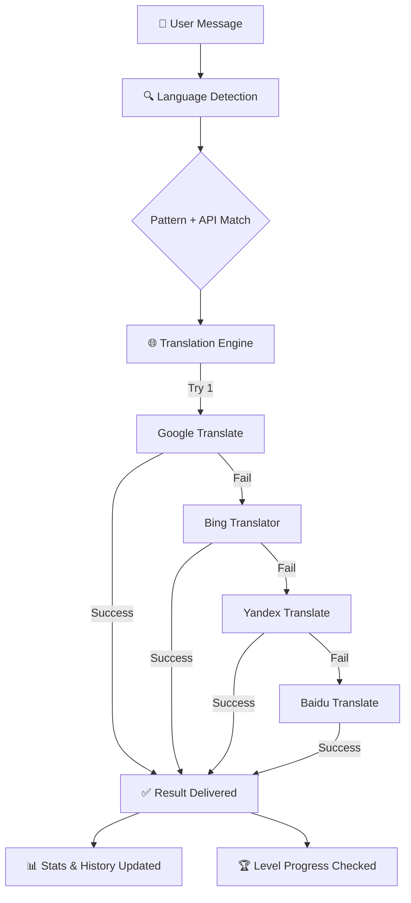

<div align="center">


<br/>


<br/>

<a href="https://python.org"></a>
<a href="https://t.me/BotamBotamBotamBot"></a>
<a href="LICENSE"></a>
<a href="https://github.com/Amin-Moniry"></a>


<br/><br/>

> **"Making language barriers disappear, one translation at a time."**


</div>

---

<div align="center">

## `◈` Overview

</div>

<div align="center">

**BotAM** is a powerful, multi-engine translation bot for Telegram with smart language detection and a professional, Persian-friendly UI. It runs input through a **4-layer fallback translation system** — if one engine fails, another instantly takes over — so a translation is never dropped.

Every session tracks **personal statistics, translation history, and a gamified level system**, all wrapped in a clean, intuitive interface. Translations complete in **under 2 seconds** across **15+ languages**, with automatic source-language detection.

</div>

<br/>


---

<div align="center">

## `◈` Why BotAM?


### Three Pillars

<table>
<tr>
<td align="center" width="260">

**`◆` Multi-Engine Translation**
<sub>4 backup systems — Google, Bing, Yandex, Baidu — chained as automatic fallbacks</sub>

</td>
<td align="center" width="260">

**`◆` Smart Language Detection**
<sub>Pattern-based script recognition (Persian, Arabic, Cyrillic, Chinese...) fused with API detection</sub>

</td>
<td align="center" width="260">

**`◆` Gamified Experience**
<sub>Personal stats, translation history, and a 5-tier level system from Beginner to Master</sub>

</td>
</tr>
</table>

</div>

<br/>


---

<div align="center">

## `◈` Key Features


<small>

| <sub>▶ Feature</sub> | <sub>Description</sub> | <sub>Status</sub> |
|:---:|:---:|:---:|
| <sub>Smart language detection</sub> | <sub>Automatically identifies input language via pattern matching and API cross-check</sub> | <sub>✅</sub> |
| <sub>Multi-engine translation</sub> | <sub>4 backup translation systems — Google, Bing, Yandex, Baidu</sub> | <sub>✅</sub> |
| <sub>4-layer fallback system</sub> | <sub>If one service fails, the next in the chain takes over automatically</sub> | <sub>✅</sub> |
| <sub>Lightning-fast responses</sub> | <sub>Translations completed in under 2 seconds</sub> | <sub>✅</sub> |
| <sub>15+ languages</sub> | <sub>Comprehensive language coverage with auto-detect</sub> | <sub>✅</sub> |
| <sub>User statistics</sub> | <sub>Detailed personal analytics and progress tracking</sub> | <sub>✅</sub> |
| <sub>Translation history</sub> | <sub>Last 10 translations saved per user</sub> | <sub>✅</sub> |
| <sub>Gamified levels</sub> | <sub>5-tier ranking from Beginner to Translation Master</sub> | <sub>✅</sub> |
| <sub>Professional UI</sub> | <sub>Clean, intuitive interface with native Persian support</sub> | <sub>✅</sub> |
| <sub>Data persistence</sub> | <sub>User preferences and history saved automatically</sub> | <sub>✅</sub> |
| <sub>24/7 uptime</sub> | <sub>Continuous service availability</sub> | <sub>✅</sub> |
| <sub>Voice translation</sub> | <sub>Speech-to-text, then translate</sub> | <sub>⏳</sub> |
| <sub>File & image translation</sub> | <sub>PDF/DOCX/TXT support, plus OCR for images</sub> | <sub>⏳</sub> |
| <sub>Personal API access</sub> | <sub>Custom API endpoint for developers</sub> | <sub>⏳</sub> |

</small>

</div>

<br/>


---

<div align="center">

## `◈` System Architecture


</div>



<br/>


---

<div align="center">

## `◈` Supported Languages

</div>

```
🇺🇸 English    🇮🇷 Persian    🇸🇦 Arabic      🇫🇷 French
🇩🇪 German     🇪🇸 Spanish    🇮🇹 Italian     🇷🇺 Russian
🇯🇵 Japanese   🇰🇷 Korean     🇨🇳 Chinese     🇹🇷 Turkish
🇵🇹 Portuguese 🇮🇳 Hindi      🇳🇱 Dutch       🔍 Auto-detect
```

<br/>


---

<div align="center">

## `◈` Bot Commands

```
/start          → initialize the bot and show the main menu
/help           → display comprehensive help guide
/stats          → show your translation statistics
/info           → display bot information and system stats
```

</div>

<br/>


---

<div align="center">

## `◈` User Levels & Gamification

<small>

| <sub>Level</sub> | <sub>Translations Required</sub> | <sub>Badge</sub> |
|:---:|:---:|:---:|
| <sub>📘 Beginner</sub> | <sub>0–49</sub> | <sub>New User</sub> |
| <sub>⭐ Advanced</sub> | <sub>50–99</sub> | <sub>Active User</sub> |
| <sub>💎 Expert</sub> | <sub>100–499</sub> | <sub>Power User</sub> |
| <sub>🏆 Professional</sub> | <sub>500–999</sub> | <sub>Expert</sub> |
| <sub>👑 Translation Master</sub> | <sub>1000+</sub> | <sub>Master</sub> |

</small>

</div>

<br/>


---

<div align="center">

## `◈` Usage Examples

</div>

**Basic translation**
```
User: Hello, how are you?
Bot:  سلام، چطور هستید؟
```

**Auto language detection**
```
User: Bonjour mon ami
Bot:  🔍 Detected: French → Persian
      سلام دوست من
```

**Settings management**
- Change source language — select from 15+ options
- Change target language — set your preferred output
- View history — last 10 translations saved
- Reset settings — return to default configuration

<br/>


---

<div align="center">

## `◈` Installation & Setup


</div>

**Prerequisites:** Python 3.9+ · a Telegram bot token from @BotFather

 &nbsp; Install dependencies

```bash
pip install python-telegram-bot==13.15
pip install translators
pip install requests
```

 &nbsp; Set your environment variables

```bash
export BOT_TOKEN="your_telegram_bot_token"
export ADMIN_ID="your_telegram_user_id"
```

 &nbsp; Run it

```bash
# This code is for viewing only — cannot be copied or used.
# To use the bot, visit: https://t.me/BotamBotamBotamBot
```

<br/>


---

<div align="center">

## `◈` Tech Stack

| Layer | Technology |
|:-----:|:----------:|
| **Language** | Python 3.9+ |
| **Bot framework** | python-telegram-bot |
| **Translation** | Google · Bing · Yandex · Baidu (4-layer fallback) |
| **Language detection** | Pattern-based regex + API cross-check |
| **Persistence** | JSON-based user database |

</div>

<br/>


---

<div align="center">

## `◈` Advanced Features

</div>

**Smart language detection**
```python
def _pattern_detect_language(self, text):
    patterns = {
        'fa': r'[\u0600-\u06FF]',    # Persian/Arabic script
        'ar': r'[\u0621-\u064A]',    # Arabic specific
        'ru': r'[а-яё]',             # Cyrillic
        'zh': r'[\u4e00-\u9fff]',    # Chinese characters
        # ... more patterns
    }
```

**Fallback chain**
```python
translators_to_try = [
    ('Google', 'google'),
    ('Bing', 'bing'),
    ('Yandex', 'yandex'),
    ('Baidu', 'baidu'),
]
```

<br/>


---

<div align="center">

## `◈` Security & Privacy

<small>

| <sub>Guarantee</sub> | <sub>Detail</sub> |
|:---:|:---:|
| <sub>No data mining</sub> | <sub>Personal conversations are not stored</sub> |
| <sub>Secure API</sub> | <sub>All translation requests are encrypted</sub> |
| <sub>Privacy first</sub> | <sub>Only translation history (optional) is saved</sub> |
| <sub>GDPR compliant</sub> | <sub>User data can be deleted on request</sub> |

</small>

</div>

<br/>


---

<div align="center">

## `◈` Viewing Only

</div>

> ⚠️ **This is proprietary software for viewing purposes only.** Shared for **educational and demonstration purposes**.

<table align="center">
<tr>
<td align="center" width="300">

**🚫 Prohibited**
<sub>No copying · no modification · no redistribution · no commercial use · no derivative works</sub>

</td>
<td align="center" width="300">

**✅ Permitted**
<sub>View the code for learning · read the documentation · use the official bot</sub>

</td>
</tr>
</table>

Interested in using this code for your own project? Contact the developer for proper licensing.

<br/>


---

<div align="center">

## `◈` Roadmap

</div>

**Upcoming**
- 🎙️ Voice translation — speech-to-text, then translate
- 📄 File support — PDF, DOCX, TXT
- 🖼️ Image translation — OCR + translate
- 🔑 Personal API — custom access for developers
- 📦 Bulk translation — multiple texts at once
- ⭐ Translation quality scoring

<small>

| <sub>Version</sub> | <sub>Highlights</sub> |
|:---:|:---|
| <sub>v6.0</sub> | <sub>Multi-engine system with 4 fallback APIs</sub> |
| <sub>v5.0</sub> | <sub>Advanced UI with gamification</sub> |
| <sub>v4.0</sub> | <sub>User statistics and history tracking</sub> |
| <sub>v3.0</sub> | <sub>Language detection improvements</sub> |
| <sub>v2.0</sub> | <sub>Multi-language support expansion</sub> |
| <sub>v1.0</sub> | <sub>Initial release</sub> |

</small>

<br/>


---

<div align="center">

## `◈` Creator

<br/>


<br/>

<table>
<tr>
<td align="center" width="210">
<a href="https://github.com/Amin-Moniry">

</a>
</td>
<td align="center" width="210">
<a href="https://t.me/BotamBotamBotamBot">

</a>
</td>
<td align="center" width="210">
<a href="https://t.me/amintivanix2">

</a>
</td>
</tr>
</table>

📧 [amintivanix2@gmail.com](mailto:amintivanix2@gmail.com) &nbsp;·&nbsp; 🌐 [allin1wrench.ir](https://allin1wrench.ir)

⭐ **If this project is useful to you, drop a star!**

</div>

<br/>


---

<div align="center">

## `◈` License

**© 2026 Amin Moniry (AminTivanix2) — All Rights Reserved**

This software is **proprietary and confidential**. Unauthorized copying, modification, distribution, or use of this software, via any medium, is strictly prohibited without the express written permission of the copyright holder. Full details in [LICENSE](LICENSE).

<br/>


<br/>


</div>
