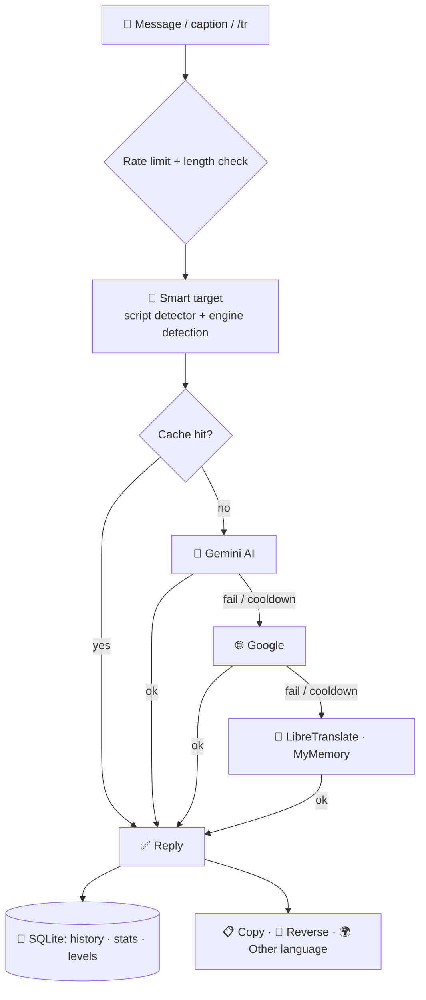

<div align="center">


<br/>


<br/>


<a href="https://t.me/BotamBotamBotamBot"></a>
<a href="LICENSE"></a>


<br/><br/>

> **"Making language barriers disappear, one translation at a time."**

</div>

---

<div align="center">

## `◈` Overview

</div>

**BotAM** is a Telegram translator built on a fully **asynchronous** core. Send any text — the language is detected automatically and the translation comes back in one message, with no extra steps. Behind it, a **self-healing engine chain** (Gemini AI → Google → LibreTranslate → MyMemory) keeps translating even when a provider is slow, rate-limited or down.

<div align="center">

| `◆` Quality | `◆` Reliability | `◆` Experience |
|:---:|:---:|:---:|
| **Gemini AI** translates with full-message context and tone — far more natural than word-by-word engines, especially for Persian | **Circuit breaker + timeouts + cache** — a failing engine is skipped automatically and retried later | **Zero-step flow**, copy / reverse / re-translate buttons, clean RTL-friendly cards |

</div>

---

<div align="center">

## `◈` What's new in v7

</div>

| | Before (v6) | Now (v7) |
|:--|:--|:--|
| **Concurrency** | Sync loop — one slow request stalled the bot | Fully async, concurrent updates, per-engine timeouts |
| **Engines** | 4 scraping-based engines tried one after another | Gemini AI + Google + LibreTranslate + MyMemory with circuit breaker & cache |
| **Language detection** | Extra API call, result discarded, regex guessed (Arabic ⇒ Persian) | Engine-reported language + offline script detector (fa/ar/ur, ja/zh/ko, ru/uk…) |
| **Output** | Markdown — backticks in user text crashed replies | HTML-escaped, long results split safely under Telegram's limit |
| **Flow** | Press "start translating" first | Just send text. Smart target when text is already in the target language |
| **Storage** | `bot_data.json` | SQLite (WAL), auto-imports old data |
| **Rank & stats** | Random rank | Real rank, real level progress |
| **Languages** | 15 | 28 (+ Azerbaijani, Kurdish, Ukrainian, Urdu…) |
| **Ops** | — | `/health` JSON, `/admin`, `/broadcast`, rate limiting, tests |

Full list in [CHANGELOG.md](CHANGELOG.md).

---

<div align="center">

## `◈` Architecture

</div>



```
bot.py                 entry point (python bot.py)
botam/
├─ app.py              wiring, logging, polling, lifecycle
├─ handlers.py         commands, buttons, translation flow
├─ translator.py       engine chain · circuit breaker · cache · smart target
├─ engines.py          Gemini · Google · LibreTranslate · MyMemory
├─ detect.py           offline script-based language guess
├─ storage.py          SQLite layer (+ legacy JSON import)
├─ ui.py               texts & keyboards (Persian, HTML)
├─ health.py           /health endpoint for Render + cron
├─ config.py           environment configuration
└─ languages.py        28 languages
tests/                 pytest suite (engines mocked)
```

---

<div align="center">

## `◈` Commands

</div>

```
/start            main menu
/tr [lang] text   one-off translation, e.g.  /tr de سلام      (reply to a message + /tr works in groups)
/lang             choose source & target language
/history          last translations
/stats            your level, rank and progress
/help  /about     guide · bot & engine info
/privacy          what is stored
/deleteme         permanently delete your data
/admin            (admin) users, translations, engine status
/broadcast text   (admin) message every user
```

**Result buttons:** 📋 copy · 🔁 reverse translation · 🌍 translate the same text to another language.

<div align="center">

| Level | Translations |
|:---:|:---:|
| 📘 Beginner | 0–49 |
| ⭐ Advanced | 50–99 |
| 💎 Expert | 100–499 |
| 🏆 Professional | 500–999 |
| 👑 Translation Master | 1000+ |

</div>

---

<div align="center">

## `◈` Supported Languages (28)

</div>

```
🇮🇷 Persian    🇺🇸 English    🇸🇦 Arabic     🇦🇿 Azerbaijani  🇹🇷 Turkish    🏳️ Kurdish    🇷🇺 Russian
🇺🇦 Ukrainian  🇫🇷 French     🇩🇪 German     🇪🇸 Spanish      🇮🇹 Italian    🇵🇹 Portuguese 🇳🇱 Dutch
🇵🇱 Polish     🇸🇪 Swedish    🇨🇿 Czech      🇷🇴 Romanian     🇭🇺 Hungarian  🇬🇷 Greek      🇨🇳 Chinese
🇯🇵 Japanese   🇰🇷 Korean     🇮🇳 Hindi      🇵🇰 Urdu         🇮🇩 Indonesian 🇻🇳 Vietnamese 🇹🇭 Thai
```

---

<div align="center">

## `◈` Configuration

</div>

| Variable | Required | Description |
|:--|:-:|:--|
| `BOT_TOKEN` | ✅ | Token from @BotFather |
| `ADMIN_ID` | | Your Telegram id (comma-separated for several) — enables `/admin`, `/broadcast`, error alerts |
| `GEMINI_API_KEY` | ⭐ | Enables the Gemini AI engine (best quality). Free key: Google AI Studio |
| `GEMINI_MODEL` | | Default `gemini-flash-latest` |
| `ENGINE_ORDER` | | Default `gemini,google,libre,mymemory` — engines are tried left → right, unavailable ones skipped |
| `LIBRETRANSLATE_URL` / `_API_KEY` | | Add a LibreTranslate instance to the chain |
| `DATA_DIR` | | Folder of `botam.db` (default `data`) |
| `PORT` | | Health server port (Render sets it) — default `10000` |
| `MAX_CHARS`, `RATE_LIMIT_COUNT`, `RATE_LIMIT_WINDOW` | | Limits (default 4000 chars, 6 requests / 20 s) |

See [`.env.example`](.env.example).

---

<div align="center">

## `◈` Deployment — Render + Cron

</div>

1. **Render → New → Web Service**, connect this repo.
   - Build: `pip install -r requirements.txt` · Start: `python bot.py` · Health check path: `/health`
   - Environment: `BOT_TOKEN`, `GEMINI_API_KEY`, `ADMIN_ID`, `PYTHON_VERSION=3.11.9`
   - (A ready [`render.yaml`](render.yaml) Blueprint is included.)
2. **Keep it awake (free plan):** create a cron job (e.g. [cron-job.org](https://cron-job.org)) that requests `https://<your-service>.onrender.com/health` **every 10 minutes**. The endpoint returns JSON with status, uptime and engine states.
3. **Persistence:** Render's free disk is ephemeral — `botam.db` is wiped on every deploy/restart. For permanent data attach a **Render Disk** and set `DATA_DIR=/var/data`.

> ⚠️ Run **one** instance only. Two instances polling the same bot token (e.g. during a deploy overlap, or locally while Render runs) cause Telegram `Conflict` errors.

**Local run**

```bash
pip install -r requirements.txt
cp .env.example .env        # fill BOT_TOKEN (+ GEMINI_API_KEY)
python bot.py
# tests
pip install -r requirements-dev.txt && pytest
```

<details>
<summary><b>🇮🇷 راهنمای فارسی دیپلوی</b></summary>

<div dir="rtl">

1. در Render یک **Web Service** بساز و ریپو را وصل کن؛ دستور شروع: `python bot.py` و مسیر Health Check: `/health`.
2. متغیرهای محیطی: `BOT_TOKEN` (الزامی)، `GEMINI_API_KEY` (برای بهترین کیفیت ترجمه)، `ADMIN_ID` (آیدی عددی تو).
3. در سایتی مثل cron-job.org هر **۱۰ دقیقه** یک درخواست GET به `https://<نام-سرویس>.onrender.com/health` بفرست تا سرویس رایگان نخوابد.
4. دیتابیس روی پلن رایگان با هر دیپلوی پاک می‌شود؛ برای ماندگاری، Render Disk اضافه کن و `DATA_DIR=/var/data` بگذار.
5. فقط **یک** نمونه از ربات باید همزمان اجرا شود.

</div>

</details>

---

<div align="center">

## `◈` Security & Privacy

</div>

| | |
|:--|:--|
| **Stored** | Telegram id, name/username, language settings, translation count, and the text + translation of the **last 20** translations (for history) |
| **Sent to third parties** | The text being translated is sent to the active engine (Gemini / Google / LibreTranslate / MyMemory) |
| **User control** | `/history` → clear history · `/deleteme` → permanently delete all data |
| **Secrets** | Token and keys only via environment variables; HTTP-client request logs (which contain the bot token in the URL) are silenced |
| **Abuse protection** | Per-user sliding-window rate limit, 4000-character cap |

Found a vulnerability? Please report it privately to the maintainer (contact below) instead of opening a public issue.

---

<div align="center">

## `◈` Roadmap

</div>

- 🎙️ Voice translation (speech-to-text → translate)
- 🖼️ Image translation (OCR + translate)
- 📄 File translation (PDF / DOCX / TXT)
- 🌐 Webhook mode
- 🐘 Optional PostgreSQL backend (persistent data on free hosting)
- 🔑 Personal API access for developers

| Version | Highlights |
|:---:|:---|
| **v7.0** | Async rewrite, Gemini AI engine, circuit breaker + cache, SQLite, new UI, 28 languages |
| v6.0 | Multi-engine system with 4 fallback APIs |
| v5.0 | Advanced UI with gamification |
| v4.0 | User statistics and history tracking |
| v3.0 | Language detection improvements |
| v2.0 | Multi-language support expansion |
| v1.0 | Initial release |

---

<div align="center">

## `◈` Creator

<a href="https://github.com/Amin-Moniry"></a>
<a href="https://t.me/BotamBotamBotamBot"></a>
<a href="https://t.me/amintivanix2"></a>

📧 [amintivanix2@gmail.com](mailto:amintivanix2@gmail.com) &nbsp;·&nbsp; 🌐 [allin1wrench.ir](https://allin1wrench.ir)

⭐ **If this project is useful to you, drop a star!**

</div>

---

<div align="center">

## `◈` License

**© 2026 Amin Moniry (AminTivanix2) — All Rights Reserved**

This software is **proprietary**: the source is published **for viewing and learning only**. Copying, modification, redistribution and commercial use require the author's written permission — see [LICENSE](LICENSE). The official bot is free to use: **[@BotamBotamBotamBot](https://t.me/BotamBotamBotamBot)**.

<br/>


</div>
